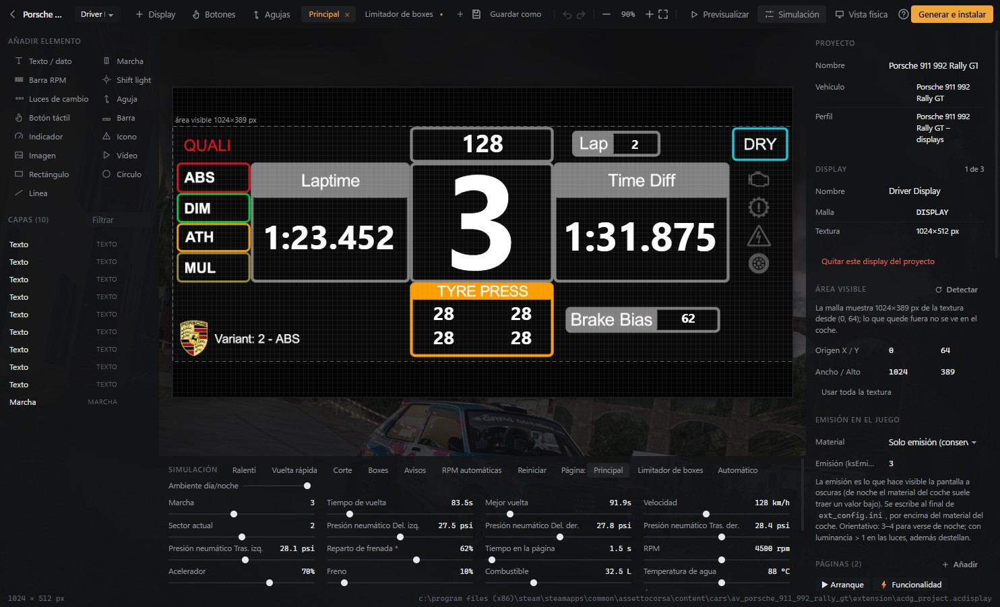
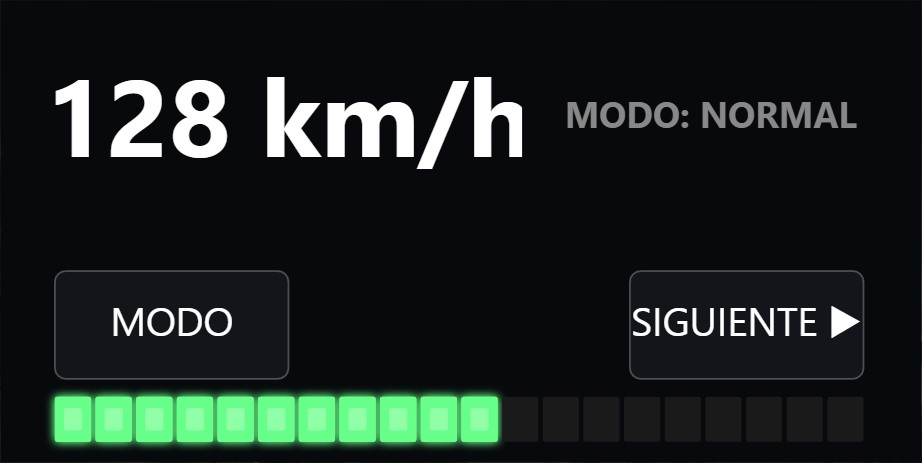
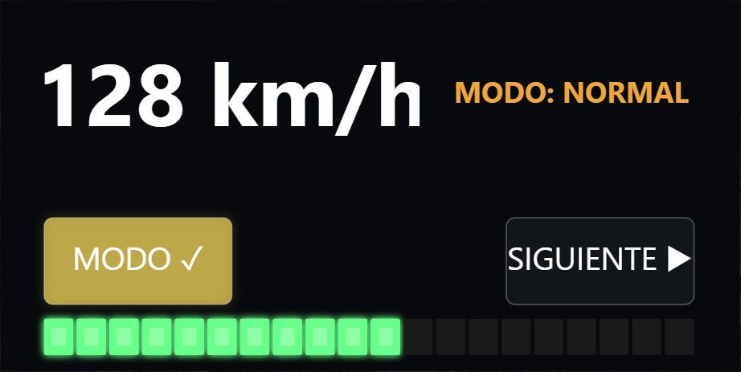

# AC Display Generator

**Editor visual de pantallas para coches de Assetto Corsa.** Diseñas lo que se ve en el display del coche (velocidad, marcha, revoluciones, tiempos, avisos, botones táctiles…) como en un programa de diseño, y la aplicación genera e instala el script Lua y la configuración que usa **Custom Shaders Patch (CSP)**, sin escribir código ni tocar `ext_config.ini` a mano.

[](https://github.com/EneasMenendez/AC-Display-Generator/releases/latest)




## Descarga

Descarga la última versión desde **[Releases](https://github.com/EneasMenendez/AC-Display-Generator/releases/latest)**:

| Archivo | Para qué |
|---|---|
| `ACDisplayGenerator-Setup-<versión>.exe` | Instalador. Deja elegir la carpeta y crea accesos en el escritorio y en el menú Inicio. |
| `ACDisplayGenerator-Portable-<versión>.exe` | Versión portátil: un solo `.exe` que funciona sin instalar. |

**Requisitos:** Windows 10/11 de 64 bits, Assetto Corsa y una versión reciente de Custom Shaders Patch. Content Manager es opcional.

> El instalador no está firmado con certificado. Si Windows muestra «Windows protegió su PC», pulsa *Más información → Ejecutar de todas formas*.

## Cómo funciona

```
 Tú diseñas en el editor  ──►  la app genera el script Lua,  ──►  CSP lo ejecuta en el juego y
 (elementos, reglas,           la sección de ext_config.ini       dibuja la pantalla del coche
  páginas, botones…)           y las imágenes, y los copia        en cada fotograma con los
                               a la carpeta del coche             datos reales
```

1. **Elige el coche** en la pantalla de inicio (doble clic).
2. **Indica cuál es la pantalla**: el asistente encuentra las que ya tenga el coche o, en el modo creador, eliges la malla del modelo 3D y detecta su resolución.
3. **Diseña** añadiendo elementos y conectándolos a datos del juego.
4. **Pruébala** con el panel de simulación, sin abrir el juego.
5. **Generar e instalar**: se escribe en el coche, con copia de seguridad previa.
6. **Mírala en Assetto Corsa** (reinicia la sesión para que CSP lea los cambios).

La aplicación incluye una guía para principiantes, **«¿Cómo funciona el programa?»** (PDF de 22 páginas con capturas y esquemas), accesible desde la pantalla de inicio y desde el editor.

## Funciones

- **Elementos**: texto y datos en vivo, marcha, barra de RPM (segmentos o continua, con zonas y limitador), shift light, luces de cambio, aguja, barra, indicador circular, iconos (integrados o propios), imagen, vídeo y formas.
- **Más de 500 variables** del coche, los neumáticos, la simulación y la sesión, con unidades métricas o imperiales y formato configurable.
- **Reglas**: color, visibilidad, parpadeo y opacidad según los datos (con RPM relativas al limitador).
- **Varios displays por coche** (conductor, copiloto, volante…) y **varias páginas** por display: normales, de arranque y de funcionalidad (launch control…), con cambio por botón de CSP o automático por condiciones, y plantillas prehechas.
- **Pantallas táctiles**: botones que se pulsan con el ratón dentro del coche para cambiar de página, accionar luces, ayudas, ERS/DRS… y seis interruptores táctiles para usar en reglas.
- **Botones físicos**: mallas del modelo 3D que se pulsan con el ratón, con zona por región UV o por punto y radio.
- **Agujas físicas**: relojes analógicos del salpicadero (`[ANALOG_INDICATOR_…]`) con recorrido valor → ángulo.
- **Simulación** en el editor (escenarios, día/noche, RPM automáticas), previsualización y vista física con la proporción real de la pantalla.
- **Importación** de displays ya existentes en el coche: el script Lua original se ejecuta en una máquina virtual aislada para convertirlo en elementos editables.
- **Instalación segura**: copia de seguridad antes de modificar nada, desinstalación y restauración desde la app, y diagnóstico que lee el registro de CSP de la última sesión.

| | |
|---|---|
|  |  |
| Botón táctil «MODO» apagado… | …y encendido: una regla pone el texto en ámbar. |

## Qué se escribe en el coche

```
content/cars/<coche>/extension/
  ext_config.ini           + sección del display entre marcadores "; ACDG BEGIN …" / "; ACDG END"
  <display>.lua            script autocontenido (configuración + runtime); <display>_acdg.lua si ya
                           existía un script ajeno con ese nombre
  imágenes / fuentes       solo las que usa el diseño
  acdg_project.acdisplay   copia del proyecto para volver a abrirlo desde el coche
  INSTALAR.txt             qué se instaló
```

Las copias de seguridad se guardan en los datos de la aplicación, no en el coche. Si el coche ya tenía un display sobre la misma malla, su sección se comenta (no se borra) y se reactiva al desinstalar.

## Desarrollo

Requisitos: Node 22+ y Windows (el empaquetado genera instalador NSIS y portable).

```bash
npm install
npm run dev         # Electron + Vite con recarga
npm test            # vitest
npm run typecheck
npm run guide       # regenera resources/docs/guia.pdf a partir de docs/guia/guia.html
npm run rig         # genera el coche de pruebas acdg_test_rig (pantallas, botones y agujas sueltos)
npm run build       # out/
npm run dist        # instalador y portable en release/
```

### Estructura

```
src/shared/          modelo del proyecto, perfil, catálogo de variables, formato, acciones táctiles y
                     generador de Lua/ini (código puro y testeable)
src/main/            proceso principal de Electron: localizador de AC/CSP, escáner de vehículos, lector kn5,
                     perfiles, proyectos, imágenes/DDS, instalador con copias de seguridad, guía, IPC
src/preload/         puente window.acdg
src/renderer/        React: inicio, asistente, editor (lienzo Canvas 2D, capas, propiedades, simulación)
                     y diálogos (instalación, botones y agujas físicos)
resources/runtime/   acdg_runtime.lua: librería que dibuja el display en CSP
resources/docs/      guía de usuario en PDF
resources/icons/     iconos integrados
resources/profiles/  perfiles de ejemplo
docs/guia/           fuente de la guía (HTML + capturas)
tools/               coche de pruebas, escritor de kn5, generador de la guía y del catálogo de variables
tests/               vitest
```

**Regla de oro:** la previsualización (`src/renderer/src/render/`) y el runtime del juego (`resources/runtime/acdg_runtime.lua`) implementan la misma semántica; cualquier cambio en uno se replica en el otro.

### Arnés de depuración

Con `ACDG_DEBUG=<carpeta>` la app vuelca la consola del renderer, ejecuta `<carpeta>/cmd.js` en el renderer (resultado en `cmd.out`), guarda `shot.png` al crear `shot.request`, y los diálogos nativos devuelven el contenido de `dialog.txt` si existe. `window.acdgStore` expone el estado (zustand).

## Autor

**Eneas Menéndez**

Assetto Corsa, Custom Shaders Patch y Content Manager pertenecen a sus respectivos autores. Este proyecto no está afiliado a ellos.
